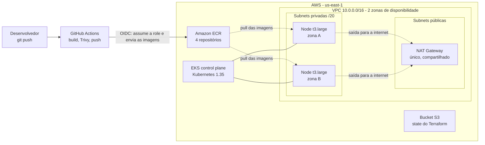
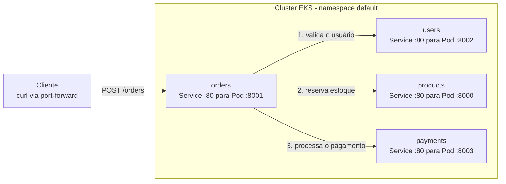
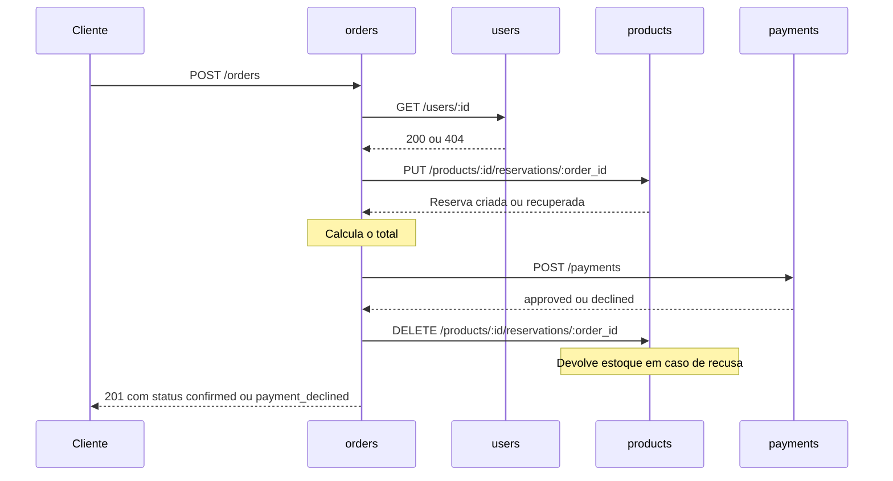
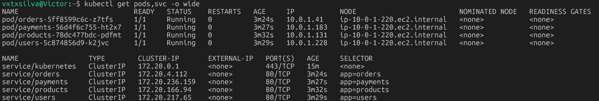

Warning: truncated output (original token count: 8890)
Total output lines: 609

# Lab E-commerce de Microsserviços no AWS EKS

[](https://github.com/vxtxbryan/lab-ecommerce-microsservicos/actions/workflows/ci.yml)

Laboratório prático de **cloud e DevOps**: quatro microsserviços de um e-commerce (Python/FastAPI) rodando em um cluster **Kubernetes na AWS (EKS)**, com infraestrutura criada por **Terraform**, deploy com **Helm** e uma pipeline de **CI no GitHub Actions** que faz build, varredura de vulnerabilidades com **Trivy** e envio das imagens para o **Amazon ECR**, autenticando na AWS por **OIDC** (sem chaves de acesso guardadas no GitHub).

O objetivo é servir como material de estudo e como referência de um fluxo completo, do código até o cluster. Se você quer aprender como as peças se encaixam, ou precisa de um ponto de partida para um projeto parecido, pode clonar, rodar e adaptar.

> **Aviso de custo:** subir o cluster na AWS **gera cobrança** (cerca de **US$ 0,32 por hora** nesta fase, e mais conforme a plataforma crescer). O passo a passo abaixo mostra como rodar tudo localmente de graça e como desligar a infraestrutura na nuvem assim que terminar. Veja a seção [Custos](#custos).

---

## Sumário

- [O que este projeto demonstra](#o-que-este-projeto-demonstra)
- [Tecnologias](#tecnologias)
- [Arquitetura](#arquitetura)
- [Estrutura do repositório](#estrutura-do-repositório)
- [Os serviços](#os-serviços)
- [Pré-requisitos](#pré-requisitos)
- [Passo a passo](#passo-a-passo)
  - [1. Rodar localmente com Docker Compose (sem custo)](#1-rodar-localmente-com-docker-compose-sem-custo)
  - [2. Preparar a conta AWS](#2-preparar-a-conta-aws)
  - [3. Criar a infraestrutura com Terraform](#3-criar-a-infraestrutura-com-terraform)
  - [4. Enviar as imagens para o ECR](#4-enviar-as-imagens-para-o-ecr)
  - [5. Conectar o kubectl ao cluster](#5-conectar-o-kubectl-ao-cluster)
  - [6. Fazer o deploy com Helm](#6-fazer-o-deploy-com-helm)
  - [7. Testar o fluxo de um pedido](#7-testar-o-fluxo-de-um-pedido)
  - [8. Desligar tudo para parar a cobrança](#8-desligar-tudo-para-parar-a-cobrança)
- [Pipeline de CI](#pipeline-de-ci)
- [Evidências do deploy](#evidências-do-deploy)
- [Decisões de projeto e limitações](#decisões-de-projeto-e-limitações)
- [Custos](#custos)
- [Problemas comuns](#problemas-comuns)
- [Próximos passos](#próximos-passos)
- [Licença](#licença)

---

## O que este projeto demonstra

- **Infraestrutura como código** com Terraform: VPC, subnets, cluster EKS, node group, repositórios ECR e a role de acesso do GitHub Actions, com o state guardado em um bucket S3.
- **Kubernetes na prática**: Deployments, Services, probes de liveness e readiness, limites de recursos e comunicação entre serviços por DNS interno.
- **Helm**: um único chart genérico (`helm/microservice`) reaproveitado pelos 4 serviços, com um arquivo de valores por serviço.
- **CI com segurança embutida**: build, varredura Trivy que reprova a pipeline em vulnerabilidades `HIGH` e `CRITICAL`, e push para o ECR.
- **Autenticação sem segredos**: o GitHub Actions assume uma role da AWS por OIDC, restrita à branch `main` deste repositório.
- **Microsserviços**: quatro APIs independentes, onde o serviço `orders` orquestra chamadas HTTP aos outros três.

## Tecnologias

| Área | Ferramenta | Observação |
|---|---|---|
| Nuvem | AWS | Região `us-east-1` |
| Orquestração | Amazon EKS (Kubernetes 1.35) | Node group de sistema: 2 nodes `t3.large` em subnets privadas |
| IaC | Terraform ≥ 1.10 | Provider AWS `~> 5.0`; módulos `terraform-aws-modules/vpc` e `eks`, mais um módulo local de IRSA (`modules/irsa`) |
| Deploy | Helm 3 | Chart genérico + values por serviço |
| Registro de imagens | Amazon ECR | 1 repositório por serviço, scan no push |
| CI | GitHub Actions | Build, Trivy, push, OIDC |
| Segurança | Trivy | Reprova em `HIGH` e `CRITICAL` com correção disponível |
| Aplicação | Python 3.12, FastAPI, Uvicorn, Pydantic | Imagem base `python:3.12-slim` |
| Local | Docker e Docker Compose | Para rodar sem custo |

## Arquitetura

A CI valida e publica imagens com SHA imutável e propõe a atualização de `helm/releases.yaml` em PR. O merge aprova a versão; o deploy ao EKS permanece manual.

### Visão da infraestrutura



### Como os serviços conversam

Os quatro serviços rodam no namespace `default` e se encontram pelo **DNS interno do Kubernetes**: o Service `users` responde em `http://users`, e assim por diante. O serviço `orders` é o único que chama os outros.



### Fluxo de um pedido



Se algum serviço estiver fora do ar, o `orders` responde `503`. Usuário ou produto inexistente retorna `404`, e estoque insuficiente retorna `400`.

## Estrutura do repositório

```text
.
├── .github/workflows/ci.yml     # Pipeline: build, Trivy e push para o ECR
├── docker-compose.yml           # Sobe os 4 serviços localmente
├── helm/
│   ├── microservice/            # Chart genérico (Deployment + Service)
│   │   ├── Chart.yaml
│   │   ├── values.yaml          # Valores padrão (réplicas, probes, recursos)
│   │   └── templates/
│   └── values/                  # Um arquivo de valores por serviço
│       ├── products.yaml
│       ├── users.yaml
│       ├── payments.yaml
│       └── orders.yaml
├── infra/terraform/
│   ├── backend.tf               # State remoto no S3 (bucket informado no init)
│   ├── backend.hcl.example      # Modelo do arquivo com o nome do seu bucket
│   ├── provider.tf              # Versões, provider AWS e default_tags
│   ├── variables.tf             # Região, versão do K8s, nodes, GitHub
│   ├── vpc.tf                   # VPC, subnets públicas/privadas e NAT
│   ├── eks.tf                   # Cluster EKS, addons e node group de sistema
│   ├── addons.tf                # Addon EBS CSI (com IRSA)
│   ├── modules/irsa/            # Módulo reutilizável: role IAM por service account
│   ├── ecr.tf                   # Repositórios ECR e política de retenção
│   ├── oidc.tf                  # Role que o GitHub Actions assume (OIDC)
│   └── outputs.tf
├── scripts/
│   ├── build-and-push.sh        # Build e push manual das imagens para o ECR
│   └── test-order.sh            # Teste de ponta a ponta de um pedido
├── services/
│   ├── products/                # API de produtos  (porta 8000)
│   ├── orders/                  # API de pedidos   (porta 8001)
│   ├── users/                   # API de usuários  (porta 8002)
│   └── payments/                # API de pagamentos (porta 8003)
└── docs/img/                    # Prints usados neste README
```

## Os serviços

Cada serviço usa sua própria tabela no DynamoDB Local via Compose. No EKS, o deploy do passo 6 configura uma tabela DynamoDB e uma role IRSA por serviço. Todos expõem `GET /health`, usado nas probes do Kubernetes, e a documentação interativa do FastAPI fica em `/docs`.

| Serviço | Porta | Rotas | Observações |
|---|---|---|---|
| `products` | 8000 | `GET /products`, `GET /products/{id}`, `POST /products`, `DELETE /products/{id}` | Corpo do `POST`: `name`, `price`, `stock` |
| `orders` | 8001 | `GET /orders`, `POST /orders` | Orquestra `users`, `products` e `payments` |
| `users` | 8002 | `GET /users`, `GET /users/{id}`, `POST /users`, `POST /users/login` | Senha armazenada como hash bcrypt; e-mail único |
| `payments` | 8003 | `GET /payments/{id}`, `POST /payments` | Simulação: **aprova 90%** e **recusa 10%** dos pagamentos |

Exemplo de corpo do `POST /orders`:

```json
{
  "user_id": "<id do usuário>",
  "product_id": "<id do produto>",
  "quantity": 2,
  "payment_method": "pix"
}
```

Formas …3890 tokens truncated…b/workflows/ci.yml` roda em cada `push` ou `pull request` que altere `services/**` (ou o próprio workflow), com um job por serviço em paralelo:


- **Em pull requests**, a pipeline só faz build e scan, e **não toca na AWS**.
- **No push para a `main`**, depois do scan, ela assume uma role da AWS e envia cada imagem ao ECR com o SHA completo do commit. O Helm usa essa mesma tag para implantar uma revisão específica.
- **Sem `AWS_PUBLISH_ENABLED=true`**, a CI mantém build, testes e scans, mas pula publicação no ECR e atualização do manifesto de release. Para habilitar publicação, configure essa variável e `AWS_ROLE_ARN` no GitHub. Isso evita chamadas AWS acidentais quando a infraestrutura está desligada.
- **Trivy:** reprova em vulnerabilidades `HIGH` e `CRITICAL` que já tenham correção disponível (`ignore-unfixed`). A action do Trivy está fixada pelo **hash do commit** e não por tag, como proteção contra ataques à cadeia de suprimentos.

### Por que OIDC?

Em vez de guardar uma chave de acesso da AWS nos *secrets* do GitHub (que pode vazar e nunca expira), o GitHub emite um token temporário a cada execução, e a AWS troca esse token por credenciais de curta duração. A role criada no `oidc.tf` só pode ser assumida por pushes na `main` **deste repositório** e só tem permissão de enviar imagens para os 4 repositórios ECR.

### Usando a CI no seu fork

1. Informe seu repositório ao Terraform (em um `terraform.tfvars`, ignorado pelo Git, ou com `-var`). São três variáveis: `github_repo` (`seu-usuario/seu-repositorio`), `github_owner_id` e `github_repo_id`. O GitHub inclui os **IDs numéricos** do dono e do repositório no token; descubra-os (repositório público):

     ```bash
     curl -s https://api.github.com/users/SEU_USUARIO | python3 -c 'import sys,json;print(json.load(sys.stdin)["id"])'
     curl -s https://api.github.com/repos/SEU_USUARIO/SEU_REPOSITORIO | python3 -c 'import sys,json;print(json.load(sys.stdin)["id"])'
     ```

2. Rode `terraform apply` e anote o output `github_actions_role_arn`.
3. No GitHub, em *Settings → Secrets and variables → Actions → aba **Variables***, crie `AWS_ROLE_ARN` com esse ARN e `AWS_PUBLISH_ENABLED` com valor `true`. São *variables*, não *secrets*, porque nenhum dos valores é sensível.
4. Faça um push na `main` e acompanhe na aba *Actions*.

## Evidências do deploy

Resultados reais de uma execução do laboratório.

**Nodes do cluster EKS** (2 nodes `Ready`):


**Pods e Services** (4 pods `1/1 Running`, todos `ClusterIP`):



**Releases Helm** (um por serviço, mesmo chart):


**Pedido ponta a ponta**, aqui com o pagamento recusado pela simulação de 10% do serviço `payments` (o `payment_id` preenchido mostra que a cobrança foi processada, e o `status` reflete a recusa):


## Decisões de projeto e limitações

Este é um laboratório de estudo, e algumas escolhas priorizam **custo e simplicidade** em vez de produção. Conhecê-las é parte do aprendizado:

| Decisão | Motivo | Em produção |
|---|---|---|
| **1 único NAT Gateway** para as 2 zonas | Nodes ficam em subnets privadas (boa prática), e o NAT custa cerca de US$ 0,045/hora mais tráfego. Um só divide o custo | 1 NAT por zona, para não ter ponto único de falha, ou VPC endpoints |
| **Endpoint público da API do EKS** | Facilita o acesso do `kubectl` de qualquer lugar (a autenticação continua exigida). Dá para restringir pela variável `cluster_endpoint_public_access_cidrs` | Restringir por CIDR ou deixar privado |
| **1 réplica por serviço** | Reduz o consumo de recursos do laboratório | Validar múltiplas réplicas e HPA no EKS |
| **ALB interno** | Apenas a rota de pedidos está publicada para a rede do laboratório | Autenticação e TLS antes de abrir acesso externo |
| **Tags imutáveis no ECR** | Rastreabilidade por commit e prevenção de sobrescrita acidental | Deploy requer `IMAGE_TAG` com um SHA publicado |
| **Containers sem privilégios** | UID 10001, filesystem somente leitura no Helm e capabilities removidas | Adicionar NetworkPolicy |

Se a resposta de pagamento se perder, a reserva fica pendente até o cliente repetir o pedido com a mesma chave de idempotência.

## Custos

Valores aproximados na região `us-east-1` (confira a [calculadora de preços da AWS](https://calculator.aws/), que muda com o tempo):

| Recurso | Custo aproximado |
|---|---|
| Control plane do EKS | US$ 0,10 por hora (só em versão com suporte padrão; a estendida custa US$ 0,60) |
| 2 nodes `t3.large` (sob demanda) | 2 × US$ 0,0832 por hora |
| NAT Gateway | US$ 0,045 por hora + tráfego, e ~US$ 0,005 por hora do IPv4 público |
| **Subtotal de EKS, dois nodes de sistema e NAT** | **cerca de US$ 0,32 por hora** |
| ALB interno | Cobrança por hora e por capacidade utilizada (LCU), adicional ao subtotal |
| ECR (armazenamento das imagens) | centavos por mês; a política de retenção mantém só as 5 últimas imagens por repositório |
| Bucket S3 do state | centavos por mês |

Somente a infraestrutura do subtotal, durante 2h, custa em torno de **US$ 0,65**. Esquecer o cluster ligado pode custar quase US$ 8 por dia e cerca de US$ 230 por mês. Karpenter, ALB e observabilidade adicionam custos. Na conta deste laboratório existem budgets mensais de US$20, US$50 e US$100, com alertas em 85%, 100% e previsão acima de 100%. Consulte a [página AWS Budgets](https://console.aws.amazon.com/billing/home#/budgets) antes de iniciar recursos.

## Problemas comuns

| Sintoma | Causa provável e solução |
|---|---|
| `Error: No configuration files` no `terraform apply` | Você está fora de `infra/terraform`. Entre na pasta e rode de novo |
| `terraform init` pede o bucket ou falha no backend S3 | Faltou `-backend-config=backend.hcl`, ou o bucket do arquivo não existe na sua conta. Veja o passo 2.2 |
| `EntityAlreadyExists` no provedor OIDC do GitHub | A conta já tem o provedor. Rode com `-var create_github_oidc_provider=false` |
| Node group passa de 12 minutos em *Still creating* | Verifique os eventos do Auto Scaling Group no console da AWS, que costumam apontar cota de vCPU ou erro de capacidade |
| Pods em `ImagePullBackOff` | As imagens não estão no ECR ou o ID de conta nos values está errado. Rode o passo 4 e confira o passo 2.3 |
| Pod reiniciando com `OOMKilled` | O limite de memória (128Mi) ficou pequeno. Aumente `resources.limits.memory` em `helm/microservice/values.yaml` |
| `error: unable to forward port` / porta em uso | Há um `port-forward` antigo rodando. Rode `kill $(jobs -p)` ou use outras portas |
| `test-order.sh` diz que não conseguiu conectar | Os serviços não estão no ar: confira `docker compose up` ou os `port-forward` |
| CI: `Not authorized to perform sts:AssumeRoleWithWebIdentity` | A trust policy da role não bate com o token. Confira o `sub` em [Usando a CI no seu fork](#usando-a-ci-no-seu-fork) (formato com IDs) e a variável `AWS_ROLE_ARN` |
| CI: Trivy reprova a pipeline | Há uma vulnerabilidade `HIGH` ou `CRITICAL` com correção. O log mostra o pacote e a versão corrigida: atualize o `requirements.txt` ou a imagem base |
| `terraform destroy` falha com `RepositoryNotEmpty` | O ECR ainda tem imagens. Use a Opção B do [passo 8](#8-desligar-tudo-para-parar-a-cobrança) |

## Monitoramento

Prometheus e Grafana cobrem métricas, dashboards e alertas. Logs JSON são consultados com `kubectl logs`. Instalação, consultas, limites e roteiro de apresentação estão em [docs/OBSERVABILITY.md](docs/OBSERVABILITY.md). Logs centralizados e tracing ficam fora desta versão.

## Próximos passos

Ideias para evoluir o projeto:

- [ ] **GitOps com ArgoCD**: o cluster passa a se sincronizar com o repositório, em vez de `helm install` manual.
- [x] **Observabilidade** com Prometheus e Grafana: métricas das APIs e Kubernetes, dashboard e alertas; validada em EKS temporário em 27/11/2026.
- [x] **Persistência e IRSA no EKS** validados com recriação dos pods e teste de acesso entre tabelas.
- [x] **Ingress interno para orders** com AWS Load Balancer Controller e IRSA, validado pelo DNS do ALB dentro da VPC.
- [x] **Endurecimento de segurança**: usuário não-root nos containers e `securityContext`; NetworkPolicy fica para expansão futura.
- [x] **Executar pytest e validar Terraform e Helm na CI**, com scan de configuração.
- [ ] **Gerenciamento de segredos** com External Secrets e AWS Secrets Manager.

Os itens essenciais estão concluídos. Em 27/11/2026, recriamos o EKS temporariamente e validamos checkout, persistência DynamoDB/IRSA, Karpenter, ALB interno e Prometheus/Grafana; depois removemos os recursos de execução para evitar custos. Permanecem os budgets e o bucket S3 do state, que têm ciclo de vida separado. Consulte [docs/ROADMAP.md](docs/ROADMAP.md) para resultados e limites, e [docs/OBSERVABILITY.md](docs/OBSERVABILITY.md) para instalação e demonstração.

## Licença

Este projeto é distribuído sob a licença **MIT**: você pode usar, copiar e adaptar livremente, em estudos ou em trabalho. Veja o arquivo [LICENSE](LICENSE).

As quatro APIs expõem `/metrics` (Prometheus) e logs JSON de requisição. O código compartilhado fica em `common/`; construa cada imagem a partir da raiz, por exemplo `docker build -f services/orders/Dockerfile .`. Rotas são registradas como templates, sem corpos, senhas ou cabeçalhos. A instrumentação não requer um coletor para iniciar.
