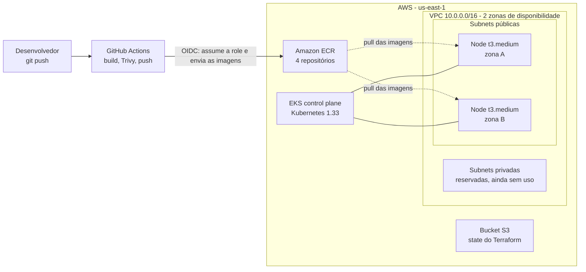
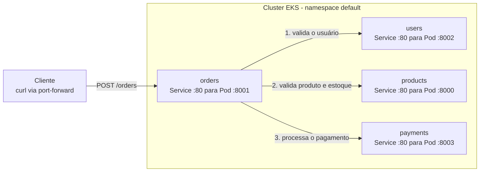
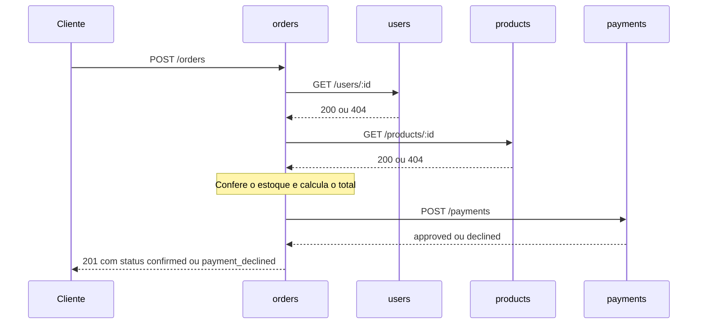
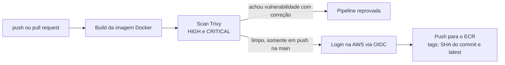
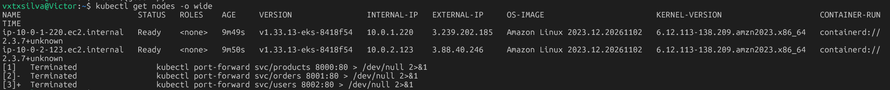
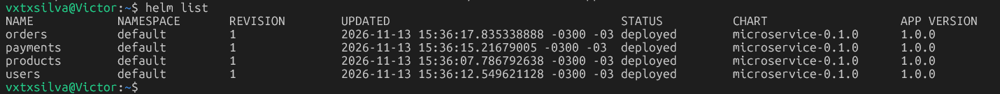
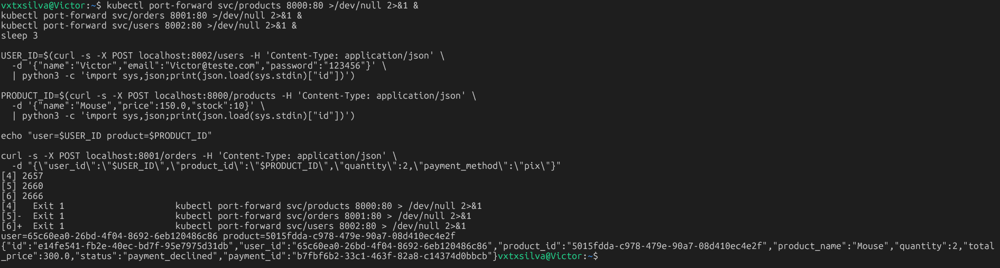

# Lab E-commerce de Microsserviços no AWS EKS

[](https://github.com/vxtxbryan/lab-ecommerce-microsservicos/actions/workflows/ci.yml)

Laboratório prático de **cloud e DevOps**: quatro microsserviços de um e-commerce (Python/FastAPI) rodando em um cluster **Kubernetes na AWS (EKS)**, com infraestrutura criada por **Terraform**, deploy com **Helm** e uma pipeline de **CI no GitHub Actions** que faz build, varredura de vulnerabilidades com **Trivy** e envio das imagens para o **Amazon ECR**, autenticando na AWS por **OIDC** (sem chaves de acesso guardadas no GitHub).

O objetivo é servir como material de estudo e como referência de um fluxo completo, do código até o cluster. Se você quer aprender como as peças se encaixam, ou precisa de um ponto de partida para um projeto parecido, pode clonar, rodar e adaptar.

> **Aviso de custo:** subir o cluster na AWS **gera cobrança** (cerca de **US$ 0,20 por hora**). O passo a passo abaixo mostra como rodar tudo localmente de graça e como desligar a infraestrutura na nuvem assim que terminar. Veja a seção [Custos](#custos).

---

## Sumário

- [O que este projeto demonstra](#o-que-este-projeto-demonstra)
- [Tecnologias](#tecnologias)
- [Arquitetura](#arquitetura)
- [Estrutura do repositório](#estrutura-do-repositório)
- [Os serviços](#os-serviços)
- [Pré-requisitos](#pré-requisitos)
- [Passo a passo](#passo-a-passo)
  - [1. Rodar localmente com Docker Compose (sem custo)](#1-rodar-localmente-com-docker-compose-sem-custo)
  - [2. Preparar a conta AWS](#2-preparar-a-conta-aws)
  - [3. Criar a infraestrutura com Terraform](#3-criar-a-infraestrutura-com-terraform)
  - [4. Enviar as imagens para o ECR](#4-enviar-as-imagens-para-o-ecr)
  - [5. Conectar o kubectl ao cluster](#5-conectar-o-kubectl-ao-cluster)
  - [6. Fazer o deploy com Helm](#6-fazer-o-deploy-com-helm)
  - [7. Testar o fluxo de um pedido](#7-testar-o-fluxo-de-um-pedido)
  - [8. Desligar tudo para parar a cobrança](#8-desligar-tudo-para-parar-a-cobrança)
- [Pipeline de CI](#pipeline-de-ci)
- [Evidências do deploy](#evidências-do-deploy)
- [Decisões de projeto e limitações](#decisões-de-projeto-e-limitações)
- [Custos](#custos)
- [Problemas comuns](#problemas-comuns)
- [Próximos passos](#próximos-passos)
- [Licença](#licença)

---

## O que este projeto demonstra

- **Infraestrutura como código** com Terraform: VPC, subnets, cluster EKS, node group, repositórios ECR e a role de acesso do GitHub Actions, com o state guardado em um bucket S3.
- **Kubernetes na prática**: Deployments, Services, probes de liveness e readiness, limites de recursos e comunicação entre serviços por DNS interno.
- **Helm**: um único chart genérico (`helm/microservice`) reaproveitado pelos 4 serviços, com um arquivo de valores por serviço.
- **CI com segurança embutida**: build, varredura Trivy que reprova a pipeline em vulnerabilidades `HIGH` e `CRITICAL`, e push para o ECR.
- **Autenticação sem segredos**: o GitHub Actions assume uma role da AWS por OIDC, restrita à branch `main` deste repositório.
- **Microsserviços**: quatro APIs independentes, onde o serviço `orders` orquestra chamadas HTTP aos outros três.

## Tecnologias

| Área | Ferramenta | Observação |
|---|---|---|
| Nuvem | AWS | Região `us-east-1` |
| Orquestração | Amazon EKS (Kubernetes 1.33) | 2 nodes `t3.medium` |
| IaC | Terraform ≥ 1.10 | Provider AWS `~> 5.0`; módulos `terraform-aws-modules/vpc` e `eks` |
| Deploy | Helm 3 | Chart genérico + values por serviço |
| Registro de imagens | Amazon ECR | 1 repositório por serviço, scan no push |
| CI | GitHub Actions | Build, Trivy, push, OIDC |
| Segurança | Trivy | Reprova em `HIGH` e `CRITICAL` com correção disponível |
| Aplicação | Python 3.12, FastAPI, Uvicorn, Pydantic | Imagem base `python:3.12-slim` |
| Local | Docker e Docker Compose | Para rodar sem custo |

## Arquitetura

### Visão da infraestrutura



### Como os serviços conversam

Os quatro serviços rodam no namespace `default` e se encontram pelo **DNS interno do Kubernetes**: o Service `users` responde em `http://users`, e assim por diante. O serviço `orders` é o único que chama os outros.



### Fluxo de um pedido



Se algum serviço estiver fora do ar, o `orders` responde `503`. Usuário ou produto inexistente retorna `404`, e estoque insuficiente retorna `400`.

## Estrutura do repositório

```text
.
├── .github/workflows/ci.yml     # Pipeline: build, Trivy e push para o ECR
├── docker-compose.yml           # Sobe os 4 serviços localmente
├── helm/
│   ├── microservice/            # Chart genérico (Deployment + Service)
│   │   ├── Chart.yaml
│   │   ├── values.yaml          # Valores padrão (réplicas, probes, recursos)
│   │   └── templates/
│   └── values/                  # Um arquivo de valores por serviço
│       ├── products.yaml
│       ├── users.yaml
│       ├── payments.yaml
│       └── orders.yaml
├── infra/terraform/
│   ├── backend.tf               # State remoto no S3
│   ├── provider.tf              # Versões do Terraform e do provider AWS
│   ├── variables.tf             # Região, nome do projeto, versão do Kubernetes
│   ├── vpc.tf                   # VPC, subnets públicas e privadas
│   ├── eks.tf                   # Cluster EKS e node group
│   ├── ecr.tf                   # Repositórios ECR e política de retenção
│   ├── oidc.tf                  # Role que o GitHub Actions assume (OIDC)
│   └── outputs.tf
├── scripts/
│   ├── build-and-push.sh        # Build e push manual das imagens para o ECR
│   └── test-order.sh            # Teste de ponta a ponta de um pedido
├── services/
│   ├── products/                # API de produtos  (porta 8000)
│   ├── orders/                  # API de pedidos   (porta 8001)
│   ├── users/                   # API de usuários  (porta 8002)
│   └── payments/                # API de pagamentos (porta 8003)
└── docs/img/                    # Prints usados neste README
```

## Os serviços

Todos guardam os dados **em memória** (não há banco de dados): ao reiniciar um pod, os dados dele são perdidos. É intencional, para manter o foco na infraestrutura. Todos expõem `GET /health`, usado nas probes do Kubernetes, e a documentação interativa do FastAPI fica em `/docs`.

| Serviço | Porta | Rotas | Observações |
|---|---|---|---|
| `products` | 8000 | `GET /products`, `GET /products/{id}`, `POST /products`, `DELETE /products/{id}` | Corpo do `POST`: `name`, `price`, `stock` |
| `orders` | 8001 | `GET /orders`, `POST /orders` | Orquestra `users`, `products` e `payments` |
| `users` | 8002 | `GET /users`, `GET /users/{id}`, `POST /users`, `POST /users/login` | Senha armazenada como hash bcrypt; e-mail único |
| `payments` | 8003 | `GET /payments/{id}`, `POST /payments` | Simulação: **aprova 90%** e **recusa 10%** dos pagamentos |

Exemplo de corpo do `POST /orders`:

```json
{
  "user_id": "<id do usuário>",
  "product_id": "<id do produto>",
  "quantity": 2,
  "payment_method": "pix"
}
```

Formas de pagamento aceitas: `credit_card`, `pix` e `boleto`.

## Pré-requisitos

| Ferramenta | Para quê | Versão |
|---|---|---|
| Git | Clonar o repositório | qualquer recente |
| Docker (e Docker Compose) | Rodar localmente e buildar imagens | recente |
| Conta AWS | Criar a infraestrutura | com permissão administrativa para o laboratório |
| AWS CLI v2 | Falar com a AWS | 2.x |
| Terraform | Criar a infraestrutura | **1.10 ou superior** (o backend usa `use_lockfile`) |
| kubectl | Operar o cluster | compatível com o Kubernetes 1.33 |
| Helm | Instalar os serviços | 3.x |

> **No Windows:** use o **WSL 2** (Ubuntu) e rode todos os comandos de dentro dele. No Docker Desktop, ative a integração com a distribuição WSL em *Settings → Resources → WSL integration*. Este projeto foi desenvolvido assim.

Para a parte local (passo 1) você só precisa de Git e Docker.

## Passo a passo

```bash
git clone https://github.com/vxtxbryan/lab-ecommerce-microsservicos.git
cd lab-ecommerce-microsservicos
```

### 1. Rodar localmente com Docker Compose (sem custo)

```bash
docker compose up --build
```

Os serviços sobem em `localhost`: products `8000`, orders `8001`, users `8002` e payments `8003`. Em **outro terminal**, rode o teste de ponta a ponta:

```bash
./scripts/test-order.sh
```

Ele cria um usuário e um produto, faz um pedido e mostra a resposta. Se aparecer `"status": "confirmed"`, o fluxo completo funcionou. Um `"status": "payment_declined"` também é um resultado válido: é a recusa simulada de 10% do serviço `payments`. Se o script não tiver permissão de execução, rode `chmod +x scripts/*.sh`.

Para encerrar, use `Ctrl+C` e depois `docker compose down`.

### 2. Preparar a conta AWS

**2.1 Configure as credenciais e confirme a conta:**

```bash
aws configure
aws sts get-caller-identity
```

**2.2 Crie o bucket S3 do state do Terraform.** Nomes de bucket são únicos no mundo todo, então o bucket do autor não serve para você. Crie o seu:

```bash
export TF_BUCKET="meu-tfstate-lab-ecommerce-$RANDOM$RANDOM"

aws s3api create-bucket --bucket "$TF_BUCKET" --region us-east-1
aws s3api put-bucket-versioning --bucket "$TF_BUCKET" \
  --versioning-configuration Status=Enabled
aws s3api put-bucket-encryption --bucket "$TF_BUCKET" \
  --server-side-encryption-configuration \
  '{"Rules":[{"ApplyServerSideEncryptionByDefault":{"SSEAlgorithm":"AES256"}}]}'
aws s3api put-public-access-block --bucket "$TF_BUCKET" \
  --public-access-block-configuration \
  BlockPublicAcls=true,IgnorePublicAcls=true,BlockPublicPolicy=true,RestrictPublicBuckets=true
```

E aponte o Terraform para ele:

```bash
sed -i "s/ecommerce-microsservicos-tfstate-6250d96a/$TF_BUCKET/" infra/terraform/backend.tf
```

> Se preferir só experimentar sem bucket, apague o arquivo `infra/terraform/backend.tf`. O state passará a ficar em um arquivo local (`terraform.tfstate`). Isso serve para estudo, mas não para trabalho em equipe. **Nunca faça commit de arquivos de state**: o `.gitignore` já os ignora.

**2.3 Troque o ID de conta AWS do autor pelo seu.** O ID `271251458777` aparece nos values do Helm e no script de push:

```bash
export AWS_ACCOUNT_ID=$(aws sts get-caller-identity --query Account --output text)
sed -i "s/271251458777/$AWS_ACCOUNT_ID/g" scripts/build-and-push.sh helm/values/*.yaml
```

**2.4 Decida se vai usar a CI do GitHub Actions.** O arquivo `infra/terraform/oidc.tf` cria a role usada pela pipeline e vem configurado para o repositório do autor.

- **Não vai usar a CI:** remova o arquivo antes do `terraform apply`:

  ```bash
  rm infra/terraform/oidc.tf
  ```

- **Vai usar a CI (no seu fork):** veja a seção [Pipeline de CI](#pipeline-de-ci), que explica o que ajustar. Se a sua conta **já tiver** um provedor OIDC do GitHub (`aws iam list-open-id-connect-providers`), o `apply` falha com `EntityAlreadyExists`, e nesse caso será preciso adaptar o `oidc.tf`.

### 3. Criar a infraestrutura com Terraform

> **Daqui em diante há cobrança.** Reserve cerca de 1h30 para executar até o passo 8 de uma vez.

Os arquivos `.tf` ficam em `infra/terraform`. Rodar o `terraform` na raiz do repositório causa o erro `No configuration files`.

```bash
cd infra/terraform
terraform init
terraform plan
terraform apply
```

Leia o plano e confirme com `yes`. A criação leva de **15 a 20 minutos**, e a maior parte é a espera do cluster EKS e do node group. Se a conexão cair, rode `terraform apply` de novo, que ele continua de onde parou. Ao final, volte para a raiz com `cd ../..`.

O que é criado: 1 VPC, 4 subnets, o cluster EKS e o node group, 4 repositórios ECR (e a role OIDC, se você manteve o `oidc.tf`).

### 4. Enviar as imagens para o ECR

O Docker precisa estar rodando. Na raiz do repositório:

```bash
./scripts/build-and-push.sh
```

O script autentica no ECR, builda as 4 imagens e as envia com a tag `latest`. Confira:

```bash
aws ecr describe-images --repository-name ecommerce-microsservicos-orders \
  --region us-east-1 --query 'imageDetails[].imageTags'
```

> Se você usa a [CI](#pipeline-de-ci), um push na branch `main` faz esse mesmo trabalho automaticamente.

### 5. Conectar o kubectl ao cluster

```bash
aws eks update-kubeconfig --region us-east-1 --name ecommerce-microsservicos
kubectl get nodes
kubectl get pods -A
```

Esperado: **2 nodes `Ready`** e os pods de sistema (`aws-node`, `coredns`, `kube-proxy`) em `Running`.

### 6. Fazer o deploy com Helm

Um release por serviço, com o chart genérico e o arquivo de valores de cada um. O **nome do release é o nome do Service**, e é por isso que `orders` consegue chamar `http://users`:

```bash
for s in products users payments orders; do
  helm install $s ./helm/microservice -f helm/values/$s.yaml
done

kubectl get pods -w
```

Aguarde os 4 pods ficarem `1/1 Running` (cerca de 15 segundos) e saia com `Ctrl+C`. Confira também com `helm list` e `kubectl get svc`.

Para atualizar depois de enviar uma imagem nova (a tag é `latest` com `pullPolicy: Always`), reinicie o Deployment:

```bash
kubectl rollout restart deployment/orders
```

### 7. Testar o fluxo de um pedido

Os Services são `ClusterIP` (internos). Para testar do seu computador, faça um port-forward com as mesmas portas do Docker Compose:

```bash
kubectl port-forward svc/products 8000:80 >/dev/null 2>&1 &
kubectl port-forward svc/orders   8001:80 >/dev/null 2>&1 &
kubectl port-forward svc/users    8002:80 >/dev/null 2>&1 &
sleep 3

./scripts/test-order.sh
```

Exemplo de resposta com pagamento aprovado:

```json
{
    "id": "7cbd9b85-2f3f-47a9-8cc8-2868e0e4094d",
    "user_id": "18014654-13b6-451a-b873-5a7489086043",
    "product_id": "df717e5c-14f9-4347-aebe-dc4ecf2a6993",
    "product_name": "Teclado",
    "quantity": 2,
    "total_price": 300.0,
    "status": "confirmed",
    "payment_id": "3280ac4c-80d4-4b83-bfa8-1d00be12e90b"
}
```

O campo `payment_id` preenchido comprova que o `orders` falou com os outros três serviços **por dentro do cluster**. Para encerrar os port-forwards: `kill $(jobs -p)`.

> O `payments` não precisa de port-forward porque só o `orders` o chama.

### 8. Desligar tudo para parar a cobrança

Primeiro remova os releases do Helm:

```bash
helm uninstall products users payments orders
```

**Opção A: desligar só o que custa dinheiro** (mantém ECR e a role OIDC, que praticamente não custam; é o que o autor faz entre uma sessão de estudo e outra):

```bash
cd infra/terraform
terraform destroy -target=module.eks -target=module.vpc
```

O Terraform avisa que o uso de `-target` pode deixar mudanças incompletas. É esperado. Para subir de novo, basta um `terraform apply`. Confira que não sobrou cluster:

```bash
aws eks list-clusters --region us-east-1
```

**Opção B: apagar absolutamente tudo.** O ECR não é removido enquanto houver imagens, então esvazie os repositórios antes:

```bash
for s in products users payments orders; do
  REPO=ecommerce-microsservicos-$s
  IDS=$(aws ecr list-images --repository-name $REPO --region us-east-1 --query 'imageIds[*]' --output json)
  [ "$IDS" != "[]" ] && aws ecr batch-delete-image --repository-name $REPO --region us-east-1 --image-ids "$IDS" >/dev/null
done

cd infra/terraform
terraform destroy
```

O bucket S3 do state **não** é apagado pelo `destroy`. Para removê-lo: `aws s3 rb s3://$TF_BUCKET --force`.

## Pipeline de CI

O workflow `.github/workflows/ci.yml` roda em cada `push` ou `pull request` que altere `services/**` (ou o próprio workflow), com um job por serviço em paralelo:



- **Em pull requests**, a pipeline só faz build e scan, e **não toca na AWS**.
- **No push para a `main`**, depois do scan, ela assume uma role da AWS e envia a imagem com duas tags: o SHA do commit (rastreável) e `latest` (a que o Helm usa).
- **Trivy:** reprova em vulnerabilidades `HIGH` e `CRITICAL` que já tenham correção disponível (`ignore-unfixed`). A action do Trivy está fixada pelo **hash do commit** e não por tag, como proteção contra ataques à cadeia de suprimentos.

### Por que OIDC?

Em vez de guardar uma chave de acesso da AWS nos *secrets* do GitHub (que pode vazar e nunca expira), o GitHub emite um token temporário a cada execução, e a AWS troca esse token por credenciais de curta duração. A role criada no `oidc.tf` só pode ser assumida por pushes na `main` **deste repositório** e só tem permissão de enviar imagens para os 4 repositórios ECR.

### Usando a CI no seu fork

1. No `infra/terraform/oidc.tf`, ajuste os dois valores dentro do bloco `locals`:
   - `github_repo`: `seu-usuario/seu-repositorio`;
   - `github_sub_repo`: o GitHub inclui os **IDs numéricos** do dono e do repositório no token. Descubra-os (repositório público) e monte o valor no formato `seu-usuario@ID_DO_USUARIO/seu-repositorio@ID_DO_REPO`:

     ```bash
     curl -s https://api.github.com/users/SEU_USUARIO | python3 -c 'import sys,json;print(json.load(sys.stdin)["id"])'
     curl -s https://api.github.com/repos/SEU_USUARIO/SEU_REPOSITORIO | python3 -c 'import sys,json;print(json.load(sys.stdin)["id"])'
     ```

2. Rode `terraform apply` e anote o output `github_actions_role_arn`.
3. No GitHub, em *Settings → Secrets and variables → Actions → aba **Variables***, crie a variável `AWS_ROLE_ARN` com esse ARN. É uma *variable*, não um *secret*, porque o ARN não é sensível.
4. Faça um push na `main` e acompanhe na aba *Actions*.

## Evidências do deploy

Resultados reais de uma execução do laboratório.

**Nodes do cluster EKS** (2 nodes `Ready`):



**Pods e Services** (4 pods `1/1 Running`, todos `ClusterIP`):


**Releases Helm** (um por serviço, mesmo chart):



**Pedido ponta a ponta**, aqui com o pagamento recusado pela simulação de 10% do serviço `payments` (o `payment_id` preenchido mostra que a cobrança foi processada, e o `status` reflete a recusa):



## Decisões de projeto e limitações

Este é um laboratório de estudo, e algumas escolhas priorizam **custo e simplicidade** em vez de produção. Conhecê-las é parte do aprendizado:

| Decisão | Motivo | Em produção |
|---|---|---|
| **Sem NAT Gateway**; nodes nas subnets públicas com IP público | O NAT Gateway custa cerca de US$ 0,045/hora mais tráfego. Sem ele, os nodes baixam imagens do ECR direto pela internet | Nodes em subnets privadas com NAT ou VPC endpoints |
| **Subnets privadas criadas mas sem uso** | Já deixam a base pronta para essa evolução | Seriam usadas pelos nodes |
| **Endpoint público da API do EKS** | Facilita o acesso do `kubectl` de qualquer lugar (a autenticação continua exigida) | Restringir por CIDR ou deixar privado |
| **1 réplica por serviço** | Os dados ficam em memória: com 2 pods, cada um teria sua própria "base" e as buscas dariam `404` de forma intermitente | Escalar depois de adotar um banco de dados |
| **Dados em memória** | Foco em infraestrutura, não em persistência | RDS, DynamoDB ou similar |
| **Services `ClusterIP` e `port-forward`** | Evita o custo de um Load Balancer | Ingress com AWS Load Balancer Controller |
| **Tag `latest` nos deploys** | Simplicidade | Tags imutáveis (SHA do commit), que a CI já publica |
| **Containers rodam como root** | Dockerfiles mínimos | Usuário não-root e `securityContext` |

Comportamentos conhecidos da aplicação: o `orders` **não decrementa o estoque** depois de um pedido confirmado e não trata falhas HTTP do `payments` além de indisponibilidade de rede.

## Custos

Valores aproximados na região `us-east-1` (confira a [calculadora de preços da AWS](https://calculator.aws/), que muda com o tempo):

| Recurso | Custo aproximado |
|---|---|
| Control plane do EKS | US$ 0,10 por hora |
| 2 nodes `t3.medium` (sob demanda) | 2 × US$ 0,0416 por hora |
| 2 endereços IPv4 públicos | ~US$ 0,005 por hora cada |
| **Total com o cluster ligado** | **cerca de US$ 0,20 por hora** |
| ECR (armazenamento das imagens) | centavos por mês; a política de retenção mantém só as 5 últimas imagens por repositório |
| Bucket S3 do state | centavos por mês |

Uma sessão completa de estudo (1h30) custa em torno de **US$ 0,30**. O que realmente pesa é **esquecer o cluster ligado**: 24 horas equivalem a quase US$ 5 e um mês inteiro a cerca de US$ 145. Considere criar um [alerta de orçamento (AWS Budgets)](https://console.aws.amazon.com/billing/home#/budgets) antes de começar.

## Problemas comuns

| Sintoma | Causa provável e solução |
|---|---|
| `Error: No configuration files` no `terraform apply` | Você está fora de `infra/terraform`. Entre na pasta e rode de novo |
| `terraform init` falha no backend S3 | O `bucket` do `backend.tf` não existe na sua conta. Veja o passo 2.2 |
| Node group passa de 12 minutos em *Still creating* | Verifique os eventos do Auto Scaling Group no console da AWS, que costumam apontar cota de vCPU ou erro de capacidade |
| Pods em `ImagePullBackOff` | As imagens não estão no ECR ou o ID de conta nos values está errado. Rode o passo 4 e confira o passo 2.3 |
| Pod reiniciando com `OOMKilled` | O limite de memória (128Mi) ficou pequeno. Aumente `resources.limits.memory` em `helm/microservice/values.yaml` |
| `error: unable to forward port` / porta em uso | Há um `port-forward` antigo rodando. Rode `kill $(jobs -p)` ou use outras portas |
| `test-order.sh` diz que não conseguiu conectar | Os serviços não estão no ar: confira `docker compose up` ou os `port-forward` |
| CI: `Not authorized to perform sts:AssumeRoleWithWebIdentity` | A trust policy da role não bate com o token. Confira o `sub` em [Usando a CI no seu fork](#usando-a-ci-no-seu-fork) (formato com IDs) e a variável `AWS_ROLE_ARN` |
| CI: Trivy reprova a pipeline | Há uma vulnerabilidade `HIGH` ou `CRITICAL` com correção. O log mostra o pacote e a versão corrigida: atualize o `requirements.txt` ou a imagem base |
| `terraform destroy` falha com `RepositoryNotEmpty` | O ECR ainda tem imagens. Use a Opção B do [passo 8](#8-desligar-tudo-para-parar-a-cobrança) |

## Próximos passos

Ideias para evoluir o projeto:

- [ ] **GitOps com ArgoCD**: o cluster passa a se sincronizar com o repositório, em vez de `helm install` manual.
- [ ] **Observabilidade** com Prometheus e Grafana: métricas dos pods e dos serviços.
- [ ] **Bancos de dados reais** (RDS ou DynamoDB), para liberar mais de uma réplica por serviço.
- [ ] **Ingress** com AWS Load Balancer Controller, para expor a API sem `port-forward`.
- [ ] **Endurecimento de segurança**: usuário não-root nos containers, `securityContext`, `NetworkPolicy`.
- [ ] **Testes automatizados** dos serviços e validação do Terraform (`fmt`, `validate`) na CI.
- [ ] **Gerenciamento de segredos** com External Secrets e AWS Secrets Manager.

## Licença

Este projeto é distribuído sob a licença **MIT**: você pode usar, copiar e adaptar livremente, em estudos ou em trabalho. Veja o arquivo [LICENSE](LICENSE).
