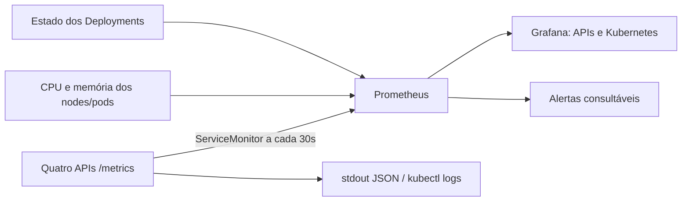

# Monitoramento do e-commerce

O escopo atual usa **Prometheus e Grafana**. Prometheus coleta séries temporais; Grafana apresenta os dados; o Alertmanager incluído no chart agrupa os alertas. Logs de requisição são JSON no stdout, acessíveis com `kubectl logs`. Não há armazenamento central de logs nem tracing distribuído nesta versão.



## Instalação

Com EKS, Karpenter e ALB Controller instalados e kubeconfig apontando para o state do laboratório:

```bash
make monitoring
IMAGE_TAG=<SHA-completo-publicado> MONITORING=true make deploy
bash scripts/test-orders-ingress.sh
make monitoring-test
```

`kube-prometheus-stack` está fixado em `93.11.0`. `helm/platform/monitoring.yaml` configura recursos e retenção; `helm/observability/` versiona dashboard e regras. Os componentes de monitoramento usam os nodes de sistema. Não criam LoadBalancer ou volumes EBS: o armazenamento é temporário. As métricas retêm até 12h/1GB e desaparecem ao remover o pod/cluster. Esta escolha reduz custo para demonstração; um ambiente permanente precisa de armazenamento persistente, retenção dimensionada e backup das configurações.

## Acesso

```bash
kubectl port-forward -n monitoring svc/monitoring-grafana 3000:80
# Em outro terminal, obtenha a senha gerada (não publique em capturas):
kubectl get secret monitoring-grafana -n monitoring -o jsonpath='{.data.admin-password}' | base64 -d
```

Abra http://localhost:3000, usuário `admin`. O dashboard **E-commerce — APIs e Kubernetes** tem dez painéis: coleta UP, requisições/s, erros 5xx, latência p95, volume na janela, réplicas, CPU, memória, respostas por status e reinícios. O chart também fornece dashboards Kubernetes. Gere tráfego com o teste de pedido; gráficos de taxa precisam de mais de uma coleta e exibem intervalos sem tráfego naturalmente.

```bash
kubectl port-forward -n monitoring svc/monitoring-kube-prometheus-prometheus 9090:9090
kubectl port-forward -n monitoring svc/monitoring-kube-prometheus-alertmanager 9093:9093
kubectl logs deployment/orders --tail=20
```

Os endpoints são internos, sem autenticação entre Prometheus e APIs; Grafana exige login. O acesso externo é somente por port-forward autenticado no Kubernetes. NetworkPolicy, autenticação das APIs e alta disponibilidade são evoluções futuras, não garantias desta configuração.

## Métricas e alertas

- `ecommerce_http_requests_total`: contador por serviço, método, template da rota e status.
- `ecommerce_http_request_duration_seconds`: histograma de latência; o dashboard calcula p95.
- IDs, senhas, bodies e cabeçalhos não são incluídos nos logs de requisição nem nos rótulos. Health checks e scrapes não contam como tráfego de negócio. Erros de servidor continuam disponíveis nos logs do runtime.
- API sem réplicas: alerta após 1 minuto; target não coletável: após 2 minutos.
- Mais de 5% de 5xx ou p95 acima de 750ms: alerta após 5 minutos e somente com mais de 20 requisições na janela. São limites didáticos a ajustar com dados reais, não um SLO contratado.

Os alertas ficam no Prometheus/Alertmanager. Não existe receiver de e-mail/Slack configurado. Para produção, escolha o destino e guarde suas credenciais fora do Git. AWS Budgets é independente e avisa sobre gastos, não sobre saúde das APIs.

## Como apresentar

Demonstre uma compra, explique a reserva de estoque e a idempotência, mostre o crescimento do contador, o p95 e os logs JSON. Explique como um erro ou Deployment indisponível vira alerta. Relacione CPU/memória com latência. Mostre que a CI testa o fluxo antes de publicar SHA imutável e que métricas não carregam dados do cliente. Por fim, justifique o escopo: métricas e alertas cobrem a operação inicial; logs centralizados e traces passam a fazer sentido quando investigar falhas distribuídas exigir mais correlação.

## Desmontagem

Remova primeiro o Ingress/ALB, depois releases de aplicações e monitoramento, depois nodes Karpenter e controllers, antes do Terraform destroy. Isso permite aos controllers remover recursos externos e seus finalizers. Consulte o README para esvaziar ECRs antes do destroy completo. Budgets existentes e o bucket de state têm ciclo de vida separado. Nunca destrua o bucket durante um apply/destroy: ele guarda o state e o lock.
